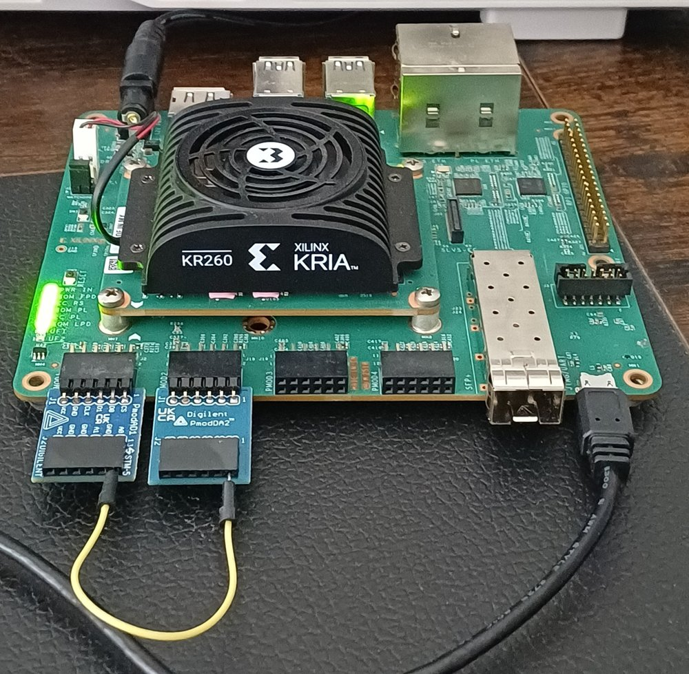
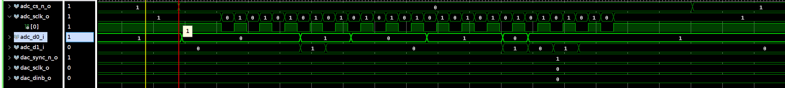
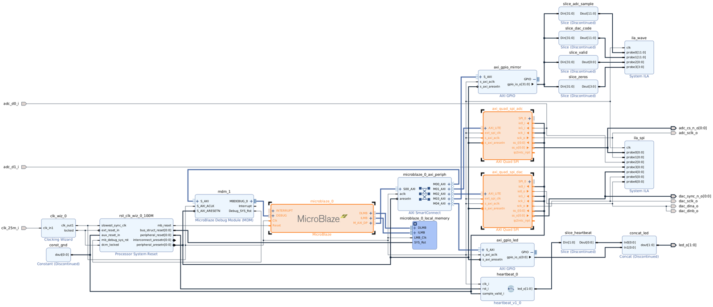
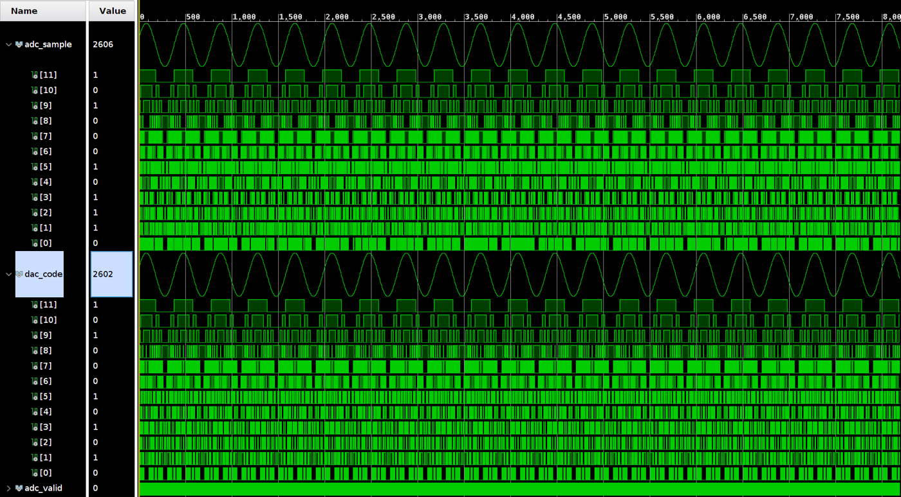
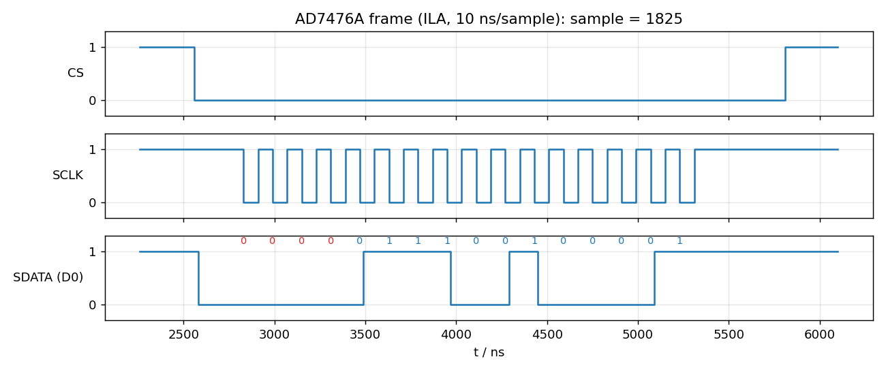

# KR260 SPI demo: a DAC and an ADC on Pmods, driven by standard Vivado IP

A small, complete example of talking to serial converters from an FPGA with catalog IP only.
A MicroBlaze writes a sine to a **DAC121S101** (Digilent Pmod DA2) and reads it back from an
**AD7476A** (Digilent Pmod AD1) through two **AXI Quad SPI** cores. Two System ILAs show the live
SPI frames and the reconstructed waveform in the Vivado Hardware Manager. No Linux, no SD card:
the PL is programmed over the on-board USB-JTAG and the design clocks itself from the carrier's
25 MHz oscillator.



The teaching point is the SPI frame of the AD7476A: with the SPI master in mode 2 (clock idle high,
data sampled on the falling edge) the received 16-bit word is `0000` followed by `DB11..DB0`, MSB first.
A master that samples on the rising edge gets the same bits shifted by one position.



## Hardware

| Item | Detail |
|---|---|
| Board | AMD Kria KR260 Robotics Starter Kit (K26 SOM, `xck26-sfvc784-2LV-c`) |
| ADC | Digilent Pmod AD1, two AD7476A, 12 bit, SPI, 3.3 V. Plugged into **PMOD1 (J2), upper row** |
| DAC | Digilent Pmod DA2, two DAC121S101, 12 bit, SPI, 3.3 V. Plugged into **PMOD2 (J18), upper row** |
| Loop | one wire from DA2 **VOUTA** (its J2 pin 1) to AD1 **A0** (its J2 pin 1). Ground is shared through the Pmod connectors, a second wire DA2 J2 pin 5 to AD1 J2 pin 2 is good practice |
| PC link | micro-USB **J4** (FTDI: JTAG and UART), Vivado 2025.2 Hardware Manager |
| Power | the KR260 power supply only. Never feed power into the DA2 output header |

Pins used (all from the KR260 carrier board files, LVCMOS33 on bank 45 unless stated). The Pmod pin is the
number on the module's J1 header. On the KR260 the upper row of a Pmod socket is header pins 1, 3, 5, 7.

| Signal | Pmod J1 pin | FPGA pin | Signal | Pmod J1 pin | FPGA pin |
|---|---|---|---|---|---|
| `adc_cs_n_o` | AD1 pin 1 | H12 | `dac_sync_n_o` | DA2 pin 1 | J11 |
| `adc_d0_i` (SDATA A) | AD1 pin 2 | E10 | `dac_dina_o` | DA2 pin 2 | J10 |
| `adc_d1_i` (SDATA B) | AD1 pin 3 | D10 | `dac_dinb_o` | DA2 pin 3 | K13 |
| `adc_sclk_o` | AD1 pin 4 | C11 | `dac_sclk_o` | DA2 pin 4 | K12 |
| `clk_25m_i` | carrier oscillator HPA_CLK0_P | C3 (LVCMOS18) | `led_o[1:0]` | user LEDs | F8, E8 (LVCMOS18) |

## What is inside



| Block | Role |
|---|---|
| `clk_wiz_0` | 25 MHz carrier clock to 100 MHz system clock, `locked` drives the reset block |
| `microblaze_0` + 64 KB local memory + MDM | runs `sw/spi_demo.c` from BRAM, the program is merged into the bitstream |
| `axi_quad_spi_adc` | AXI Quad SPI, 16-bit transfers, manual slave select, SCLK = 100 MHz / 16 = 6.25 MHz, run-time SPI mode 2 (CPOL 1, CPHA 0) |
| `axi_quad_spi_dac` | same core, SPI mode 1 (CPOL 0, CPHA 1), MOSI drives DINA and DINB, SS is the DAC SYNC |
| `axi_gpio_mirror` | 32-bit register the software writes once per conversion: sample, DAC code, valid toggle, leading-zero nibble |
| `axi_gpio_led`, `heartbeat_0` | LED1 toggles from software, LED0 blinks at 1 Hz from a free-running divider in `hdl/rtl/heartbeat.vhd` |
| `ila_spi` | System ILA on the seven pin nets, 4096 samples at 100 MHz, trigger on the falling edge of CS |
| `ila_wave` | System ILA on the mirror slices, 8192 samples, one stored row per conversion |

The software loop: write the next sine point to the DAC, wait about 5 µs for settling, read the
ADC four times, publish sample and code through the mirror register. Measured on the board:

| Quantity | Value |
|---|---|
| SCLK | 160 ns, 6.25 MHz, 16 falling edges per frame |
| CS low per ADC conversion | 3.25 µs, one conversion every 4.10 µs inside the group of four |
| Loop period, one DAC update | 30.45 µs, 32.8 kHz |
| Sine | 100 points, 328 Hz, codes 256 to 3840 |
| ADC sample minus DAC code | +1.5 LSB mean, 1.7 LSB standard deviation, worst +4 LSB |



## Build

Requirements: Vivado 2025.2 and Vitis 2025.2 on Linux, the KR260 board files (part of the Vivado
install since 2022.2), Python 3. The scripts are written for batch mode and take about 15 minutes.

```bash
source /opt/Xilinx/2025.2/2025.2/Vivado/settings64.sh
source /opt/Xilinx/2025.2/2025.2/Vitis/settings64.sh

cd vivado/scripts
vivado -mode batch -source create_project.tcl   # project + block design + IP, writes docs/block_design.*
vivado -mode batch -source build.tcl            # synthesis, implementation, bitstream, .ltx, .xsa, .mmi, reports
cd ../../sw
vitis -s build_sw.py                            # MicroBlaze program -> sw/output/spi_demo.elf
./merge_elf.sh                                  # updatemem -> vivado/output/kr260_spi_demo_sw.bit
```

`build.tcl` exits non-zero when a timing constraint is not met. Everything under `vivado/build`,
`vivado/output` and `sw/build` is generated and ignored by git.

Board files: `create_project.tcl` looks for `xilinx.com:kr260_som:part0:1.1` in the Vivado install.
If your install lacks it, copy the `kr260_som` and `kr260_carrier` folders of the
[Xilinx board store](https://github.com/Xilinx/XilinxBoardStore) into `vivado/board_files/Xilinx/`
and the script picks them up.

## Simulate

`vivado/scripts/sim_closed_loop.tcl` runs the block design in xsim with the MicroBlaze executing the
real program, and behavioural models of the two chips wired DAC to ADC (`hdl/sim/models`). It exits 0
only when the testbench reports PASS: 16 clocks per frame, four leading zeros, the DAC sequence in
order, ADC samples equal to the DAC codes.

```bash
cd vivado/scripts
vivado -mode batch -source sim_closed_loop.tcl   # about 10 minutes, needs the project and the ELF
```

## Run on the board

```bash
cd vivado/scripts
vivado -mode batch -source program.tcl           # programs kr260_spi_demo_sw.bit, attaches the .ltx, lists both ILAs
```

LED0 blinks at 1 Hz as soon as the bitstream is in (clock and MMCM alive), LED1 blinks when the
software loop runs. Then open the Hardware Manager with the helper procedures:

```bash
vivado -mode gui -source hw_demo.tcl -tclargs -autoconnect
```

| Command | What it does |
|---|---|
| `demo_connect` | hw_server, JTAG target, `xck26`, attaches `vivado/output/kr260_spi_demo.ltx` |
| `demo_setup` | `ila_spi`: trigger on CS falling, trigger position 256. `ila_wave`: store one row per toggle of `adc_valid` |
| `demo_arm` | arms `ila_spi`, waits, uploads and displays one SPI frame |
| `demo_arm_wave` | arms `ila_wave`, uploads and displays the sine, set `adc_sample` and `dac_code` to waveform style Analog once |
| `demo_save_csv` | arms both ILAs and writes the captures as CSV to `vivado/output` |
| `demo_status` | prints the ILA control properties and probe compare values |

`vivado/scripts/analyze_ila_csv.py <ila_spi.csv> <ila_wave.csv> --png-dir <dir>` decodes the CSV files:
it counts the clock edges, samples the data line on every falling edge, checks the leading zeros and the
DAC frame, and compares the read-back samples with the written codes.

## The ILA views

`ila_spi` shows the pins: `adc_cs_n_o`, `adc_sclk_o`, `adc_d0_i`, `adc_d1_i`, `dac_sync_n_o`,
`dac_sclk_o`, `dac_dinb_o`. In a frame you see CS going low at the trigger marker, 16 falling edges of
SCLK, and on `adc_d0_i` four zeros followed by DB11 to DB0. The AD7476A has no command bits: CS alone
starts the conversion and the chip launches a bit after every falling edge. The DAC frame is 16 bits
as well: two don't-care bits, two power-down bits (00 for normal operation) and the 12-bit code, latched
on the falling edges while SYNC is low.



`ila_wave` shows the software's view: `adc_sample`, `dac_code`, `adc_valid` and `adc_zeros` (the
leading-zero nibble, must stay 0). With the two 12-bit signals set to the analog waveform style, the
sine appears, four samples per DAC step.

## Notes on Vivado 2025.2

- System ILA probes carry the block-design net names in the hw_probe property `NAME.CUSTOM`. The
  property `NAME` is the generic `spi_demo_bd_i/ila_spi/U0/probeN`. The scripts match on `NAME.CUSTOM`.
- `display_hw_ila_data -wcfg` is refused in hardware mode. Each ILA gets its own waveform window at the
  first upload of a session and keeps radix, zoom and analog style afterwards.
- A System ILA on pad nets needs IOB=FALSE on the AXI Quad SPI output registers, otherwise DRC
  PDRC-248 stops the bitstream. `vivado/scripts/pre_place.tcl` sets it as a pre-place hook.
- `proc_sys_reset` derives `C_EXT_RESET_HIGH` from the polarity of the pin that drives `ext_reset_in`
  and ignores a user value. `create_bd.tcl` feeds `locked` into `ext_reset_in` and verifies the
  propagated polarity after validation.
- The MDM JTAG UART blocks `xil_printf` when no terminal is attached. The program prints only when
  compiled with `SPI_DEMO_VERBOSE`.

## Layout

```
hdl/rtl/heartbeat.vhd            LED divider, the only hand-written RTL in the design
hdl/sim/tb_spi_demo_bd.vhd       xsim testbench around the block design wrapper
hdl/sim/models/                  behavioural AD7476A and DAC121S101 models with datasheet timing checks
sw/spi_demo.c                    register-level MicroBlaze program (AXI Quad SPI registers, no driver needed)
sw/build_sw.py, merge_elf.sh     Vitis build and updatemem merge
vivado/constraints/              pins, timing, implementation constraints
vivado/scripts/                  create_project, create_bd, build, pre_place, program, hw_demo, sim_closed_loop, analyze_ila_csv
docs/                            pictures used in this README
```

## License

MIT, see `LICENSE`. The AMD IP cores and the KR260 board files are not part of this repository.
